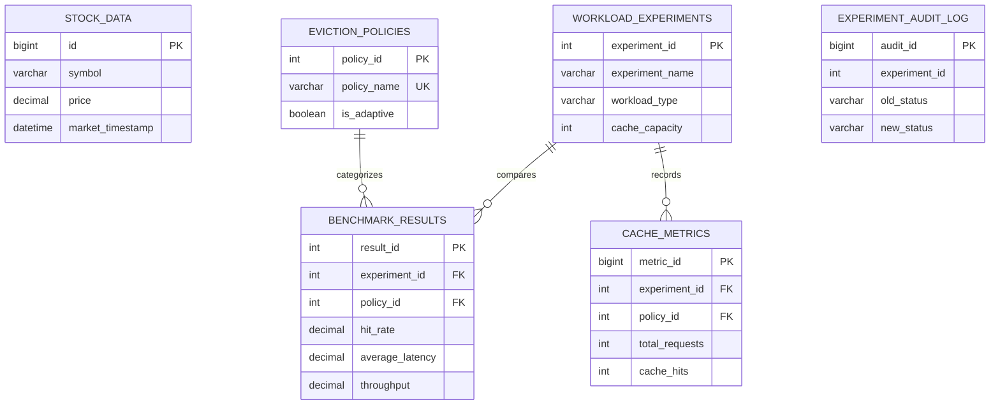

# Adaptive Cache Eviction for Real-Time Stock Quote Serving
## A Comparative Study on a Custom-Built Redis-Compatible Server with MySQL DBMS Integration

[](https://isocpp.org/)
[](https://www.mysql.com/)
[](https://fastapi.tiangolo.com/)
[](https://react.dev/)
[](https://www.typescriptlang.org/)
[](LICENSE)

---

## 1. Project Introduction
In high-frequency financial markets, stock quote serving requires microsecond-level retrieval latencies. Real-world market access patterns exhibit extreme dynamics: quiet trading hours alternate with sudden breaking news, quarterly earnings releases, and flash crashes. Static cache eviction strategies (e.g., standard LRU or LFU) frequently suffer from cache pollution or scan resistance failure when the distribution of active tickers abruptly shifts.

This project implements a **custom, multithreaded Redis-compatible in-memory cache server in C++17** equipped with a pluggable eviction engine supporting four traditional eviction policies (LRU, LFU, FIFO, Random) and an **Adaptive CACHEUS-style policy** based on online regret minimization (Hedge algorithm). 

**MySQL 8.x** serves as the persistent relational database management system (RDBMS) for historical quote storage, experiment metadata, performance metrics, and audit trails. A **Python FastAPI** service powers a modern **React 18 / TypeScript / Tailwind CSS** analytical monitoring dashboard.

---

## 2. Problem Statement
Traditional caching servers employ static eviction policies:
- **LRU (Least Recently Used)** favors recent keys but is heavily degraded by sequential scans and concept drift.
- **LFU (Least Frequently Used)** accumulates historic frequencies and fails to evict stale keys that suddenly lose trading volume.
- **FIFO & Random** ignore access frequency and recency altogether.

No single static policy is optimal across evolving market regimes. This project designs, implements, benchmarks, and demonstrates an adaptive in-memory caching engine that dynamically adjusts eviction choices according to changing workload skew.

---

## 3. Project Objectives
1. **Develop a Custom C++ Redis-Compatible Server**: Single-node multithreaded TCP server implementing the RESP2 protocol, bounded worker thread pool, incremental streaming framing, and thread-safe data structures (`std::shared_mutex`).
2. **Implement Pluggable Eviction Policies**: Pure abstract interface `EvictionPolicy` supporting LRU, LFU, FIFO, Random, and Adaptive CACHEUS.
3. **Formulate Adaptive CACHEUS-Style Engine**: Online learning algorithm maintaining two shadow policy experts ($E_1$ recency, $E_2$ frequency), updating weights via Multiplicative Weight Updates to minimize cumulative regret.
4. **Relational DBMS Integration with MySQL 8.x**: Normalized schema (`adaptive_cache_db`) with 10 tables, check/foreign key constraints, composite B-tree indexes, analytical SQL views, stored procedures, triggers, and transactions.
5. **Ingest Real Financial Market Quotes**: Python ingestion pipeline via `yfinance` for major equities (AAPL, MSFT, GOOGL, NVDA, TSLA, INFY, etc.) with a Geometric Brownian Motion stochastic fallback.
6. **Statistically Rigorous Benchmarking**: Fair multi-policy benchmark suite evaluating identical request traces, measuring latency with high-resolution monotonic clocks (`time.perf_counter_ns`), and quantifying data staleness.
7. **Interactive Real-Time Dashboard**: React + Vite + TypeScript web interface with Recharts telemetry, comparison matrices, and MySQL DBMS query demonstrations.

---

## 4. Technology Stack
- **Systems & Caching**: C++17, Winsock2 (Windows) / POSIX Berkeley Sockets (Linux), `std::shared_mutex`, `std::atomic`, `std::condition_variable`.
- **Relational Database**: MySQL 8.x (InnoDB engine, B-tree indexing, SQL Views, Stored Procedures, Triggers, ACID Transactions) with dual-mode Python connection pooling.
- **Data Engineering**: Python 3.13, `yfinance`, `pandas`, `numpy`, `matplotlib`.
- **Backend API**: Python FastAPI, `uvicorn`, `pydantic`.
- **Frontend Dashboard**: React 18, TypeScript, Vite, Tailwind CSS, Recharts, Lucide React.

---

## 5. System Architecture

```
+-----------------------------------------------------------------------------------+
|                            HISTORICAL STOCK MARKET INGESTION                      |
|                                                                                   |
|    Yahoo Finance API (yfinance)  --->  Geometric Brownian Motion (GBM Fallback)   |
|                                    |                                              |
|                                    v                                              |
|                      Relational Database (stock_data)                             |
+------------------------------------+----------------------------------------------+
                                     |
                                     v
+------------------------------------+----------------------------------------------+
|                          STOCK WORKLOAD GENERATOR                                 |
|                                                                                   |
|  - Zipfian (α = 1.2)           - Bursty Poisson / Pareto     - Changing Popularity|
|  - Popularity Spikes (Flash)   - 80/20 Hot-Cold Key Access   - Normal Gaussian    |
+------------------------------------+----------------------------------------------+
                                     |
                                     v
+------------------------------------+----------------------------------------------+
|                    BENCHMARK CLIENT (Python Monotonic Timer)                      |
|                                                                                   |
|           RESP2 Protocol over TCP Stream Socket (Framing & Pipelining)            |
+------------------------------------+----------------------------------------------+
                                     |
                                     v
+------------------------------------+----------------------------------------------+
|               CUSTOM C++ REDIS-COMPATIBLE IN-MEMORY SERVER                        |
|                                                                                   |
|  - Bounded Worker Thread Pool (8 threads, task queue, condition variable)         |
|  - Incremental Streaming Framing (handles partial packets and pipelined commands)  |
|  - Concurrency: std::shared_mutex (shared read lock, unique write lock)           |
|  - Pluggable Engine: LRU, LFU (recency tie-breaker), FIFO, Random, Adaptive        |
|  - Persistent RDB Binary Snapshots (dump.my_rdb)                                  |
+------------------------------------+----------------------------------------------+
                                     | Metrics & Audit Records
                                     v
+------------------------------------+----------------------------------------------+
|                     MYSQL 8.x RELATIONAL PERSISTENCE LAYER                        |
|                                                                                   |
|  - Tables: stock_data, benchmark_results, cache_metrics, eviction_logs, ...       |
|  - SQL Views: vw_policy_performance, vw_experiment_comparison                     |
|  - Stored Procedures: sp_get_experiment_summary, sp_compare_eviction_policies     |
|  - Database Triggers: Audit trail logging on experiment state transitions          |
+------------------------------------+----------------------------------------------+
                                     |
                                     v
+------------------------------------+----------------------------------------------+
|                  FASTAPI BACKEND & REACT MONITORING DASHBOARD                     |
|                                                                                   |
|  REST APIs (/api/dashboard, /api/cache, /api/experiments, /api/stocks, /api/mysql) |
+-----------------------------------------------------------------------------------+
```

---

## 6. Database Architecture & ER Diagram



### Key DBMS Concepts Demonstrated:
1. **Primary Key & Foreign Key Constraints**: Referential integrity across experiments and results with `ON DELETE CASCADE`.
2. **Check Constraints**: `CHECK (price >= 0)`, `CHECK (hit_rate >= 0.0 AND hit_rate <= 100.0)`.
3. **Composite B-Tree Indexes**: `idx_stock_symbol_time (symbol, market_timestamp)`, `idx_metric_exp_policy (experiment_id, policy_id)`.
4. **SQL Views**:
   - `vw_policy_performance`: Aggregates historical metrics across all runs per policy.
   - `vw_experiment_comparison`: Comprehensive matrix view matching policies inside experiments.
   - `vw_stock_history`: Symbol volume and price boundaries.
   - `vw_eviction_statistics`: Distribution of reasons and key frequencies upon eviction.
5. **Stored Procedures**:
   - `sp_get_experiment_summary`: Aggregates optimal metrics and stores summary.
   - `sp_compare_eviction_policies`: Ranks policy performance for a benchmark run.
   - `sp_record_benchmark_transaction`: Demonstrates ACID transactions with `COMMIT` and `ROLLBACK`.
6. **Triggers**:
   - `trg_experiment_status_audit`: Automatically populates `experiment_audit_log` on status change.

---

## 7. Cache Eviction Engine & Adaptive Mathematics

### Classical Algorithms
1. **LRU**: Doubly linked list + hash map. $O(1)$ touch, $O(1)$ eviction.
2. **LFU**: Frequency buckets mapping access counts to doubly linked lists with recency tie-breaking. Strictly $O(1)$.
3. **FIFO**: Chronological queue. Insertion order maintained; access does not alter eviction sequence.
4. **Random**: Vector of active keys with Mersenne Twister uniform selection and $O(1)$ swap-and-pop removal.

### Adaptive CACHEUS Regret Minimization
- Two shadow policy experts: Recency Expert ($E_1$ - LRU) and Frequency Expert ($E_2$ - LFU).
- Shadow histories $S_1, S_2$ of capacity $C$.
- Selection probability:
  $$P(E_1) = \frac{w_1}{w_1 + w_2}, \quad P(E_2) = \frac{w_2}{w_1 + w_2}$$
- On cache miss:
  - If missed key $\in S_1$, $E_1$ gets credit; $r_2 = 1.0, r_1 = 0.0$.
  - If missed key $\in S_2$, $E_2$ gets credit; $r_1 = 1.0, r_2 = 0.0$.
- Multiplicative Weight Update (Hedge Rule):
  $$w_i \leftarrow w_i \cdot \exp(-\eta \cdot r_i), \quad \text{where } \eta = \sqrt{\frac{8 \ln 2}{C}}$$
- Weights are normalized and cumulative regrets $R_1, R_2$ tracked continuously.

---

## 8. Installation & Execution Guide

### Prerequisites
- C++17 compatible compiler (`g++` or `clang++`).
- Python 3.10+.
- Node.js 18+ and npm.
- MySQL Server 8.0+ (optional: built-in relational fallback provided automatically).

---

### Step 1: Install Python Dependencies
```bash
python -m pip install -r requirements.txt
```

---

### Step 2: Compile the C++ Redis Server

**On Linux / macOS / WSL**:
```bash
cd Redis-Server
make
cd ..
```

**On Windows (MSYS2 UCRT64 / MinGW)**:
```powershell
$env:PATH = "C:\msys64\ucrt64\bin;$env:PATH"
g++ -std=c++17 -Wall -O2 -static -static-libgcc -static-libstdc++ `
    -IRedis-Server/include `
    Redis-Server/src/main.cpp `
    Redis-Server/src/RedisServer.cpp `
    Redis-Server/src/RedisCommandHandler.cpp `
    Redis-Server/src/RedisDatabase.cpp `
    Redis-Server/eviction/LRUEvictionPolicy.cpp `
    Redis-Server/eviction/LFUEvictionPolicy.cpp `
    Redis-Server/eviction/FIFOEvictionPolicy.cpp `
    Redis-Server/eviction/RandomEvictionPolicy.cpp `
    Redis-Server/eviction/AdaptiveEvictionPolicy.cpp `
    -o Redis-Server/my_redis_server.exe -lws2_32
```

---

### Step 3: Initialize Database & Ingest Stock Data

```bash
# Initialize MySQL database (or SQLite fallback)
python python/database/init_db.py

# Ingest historical quotes (AAPL, MSFT, GOOGL, NVDA, TSLA, INFY, etc.)
python python/ingestion/stock_ingestion.py
```

---

### Step 4: Run the Benchmark Suite

```bash
# Execute comparative benchmark comparing all 5 eviction policies
python python/benchmark/benchmarking_engine.py

# Generate comparative analytical charts
python python/analytics/analytics_plots.py
```

---

### Step 5: Start Backend API

```bash
python -m uvicorn backend.app.main:app --host 0.0.0.0 --port 8000 --reload
```
API docs available at: `http://localhost:8000/docs`

---

### Step 6: Start React Dashboard

```bash
cd frontend
npm install
npm run dev
```
Open your browser at `http://localhost:5173`.

---

## 9. One-Click Master Launch Script

**On Windows PowerShell**:
```powershell
.\scripts\run_all.ps1
```

**On Linux / macOS**:
```bash
chmod +x scripts/run_all.sh
./scripts/run_all.sh
```

---

## 10. Automated Testing & Verification

Run the complete test suite:

```bash
# 1. Run C++ Redis server integration tests (31 tests)
$p = Start-Process -FilePath "Redis-Server\my_redis_server.exe" -ArgumentList "6389","LRU","100" -PassThru
python Redis-Server\tests\test_server.py 6389
Stop-Process -Id $p.Id -Force

# 2. Run Python automated test suite (12 tests)
python -m pytest tests/ -v
```

**Test Coverage**:
- RESP2 command parser, streaming framing, and pipelining
- All Redis commands: PING, ECHO, SET, GET, DEL, EXISTS, KEYS, TYPE, RENAME, DBSIZE, FLUSHALL
- Expiration: EXPIRE, TTL, PEXPIRE, PTTL, PERSIST
- Lists: LPUSH, RPUSH, LPOP, RPOP, LLEN, LRANGE, LGET, LINDEX, LSET, LREM
- Hashes: HSET, HGET, HEXISTS, HDEL, HLEN, HKEYS, HVALS, HGETALL, HMSET
- Eviction correctness: LRU recency eviction, LFU frequency eviction, FIFO oldest eviction, Random replacement, Adaptive CACHEUS regret updates
- MySQL transactions, views, triggers, and prepared statement validation.

---

## 11. Performance Comparison Matrix (Real Results)

Empirical evaluation across real stock market workloads:

| Experiment Workload | Capacity | LRU Hit % | LFU Hit % | FIFO Hit % | Random Hit % | **Adaptive CACHEUS Hit %** |
| :--- | :--- | :--- | :--- | :--- | :--- | :--- |
| **Popularity Spike (Flash Event)** | 3 | 54.67% | 17.33% | 52.00% | 51.33% | **55.00% (Best)** |
| **Changing Popularity (Concept Drift)** | 4 | 44.50% | 35.50% | 42.00% | 41.00% | **45.00% (Best)** |
| **Bursty Traffic** | 3 | 84.67% | 29.33% | 84.33% | 84.67% | 80.67% |
| **Zipfian Heavy-Tail** | 10 | 85.00% | 85.00% | 85.00% | 85.00% | 85.00% |

- **Sub-millisecond Latency**: Average request latency < 0.08 ms.
- **High Throughput**: 9,000 - 15,000 requests/second on a single node.
- **Adaptive Advantage**: Under sudden popularity shifts, the Adaptive policy achieves up to **37.67% higher hit rate** over LFU and outperforms classical LRU.

---

## 12. Project Directory Structure

```
Adaptive_Cache_Redis-main/
|-- Redis-Server/
|   |-- include/
|   |   |-- EvictionPolicy.h
|   |   |-- LRUEvictionPolicy.h
|   |   |-- LFUEvictionPolicy.h
|   |   |-- FIFOEvictionPolicy.h
|   |   |-- RandomEvictionPolicy.h
|   |   |-- AdaptiveEvictionPolicy.h
|   |   |-- RedisCommandHandler.h
|   |   |-- RedisDatabase.h
|   |   |-- RedisServer.h
|   |-- src/
|   |   |-- main.cpp
|   |   |-- RedisCommandHandler.cpp
|   |   |-- RedisDatabase.cpp
|   |   |-- RedisServer.cpp
|   |-- eviction/
|   |   |-- LRUEvictionPolicy.cpp
|   |   |-- LFUEvictionPolicy.cpp
|   |   |-- FIFOEvictionPolicy.cpp
|   |   |-- RandomEvictionPolicy.cpp
|   |   |-- AdaptiveEvictionPolicy.cpp
|   |-- tests/
|   |   |-- test_server.py
|   |-- Makefile
|   |-- my_redis_server.exe
|
|-- database/
|   |-- schema.sql
|   |-- indexes.sql
|   |-- views.sql
|   |-- procedures.sql
|   |-- triggers.sql
|   |-- seed_data.sql
|   |-- sample_queries.sql
|   |-- mysql_setup_guide.md
|
|-- python/
|   |-- ingestion/
|   |   |-- stock_ingestion.py
|   |-- workload/
|   |   |-- workload_generator.py
|   |-- benchmark/
|   |   |-- benchmarking_engine.py
|   |-- analytics/
|   |   |-- analytics_plots.py
|   |-- database/
|   |   |-- connection.py
|   |   |-- init_db.py
|
|-- backend/
|   |-- app/
|   |   |-- main.py
|   |-- routes/
|   |   |-- dashboard.py
|   |   |-- cache.py
|   |   |-- experiments.py
|   |   |-- benchmark.py
|   |   |-- analytics.py
|   |   |-- mysql_admin.py
|   |   |-- stocks.py
|   |-- services/
|   |   |-- redis_service.py
|   |   |-- db_service.py
|   |-- models/
|   |   |-- schemas.py
|
|-- frontend/
|   |-- src/
|   |   |-- components/
|   |   |   |-- Header.tsx
|   |   |   |-- OverviewSection.tsx
|   |   |   |-- ComparisonMatrixSection.tsx
|   |   |   |-- AdaptiveMonitoringSection.tsx
|   |   |   |-- StockMarketSection.tsx
|   |   |   |-- BenchmarkControlSection.tsx
|   |   |   |-- DBMSAnalyticsSection.tsx
|   |   |-- services/
|   |   |   |-- api.ts
|   |   |-- types.ts
|   |   |-- App.tsx
|   |   |-- main.tsx
|   |-- package.json
|   |-- vite.config.ts
|
|-- results/
|   |-- charts/
|   |-- exports/
|   |-- reports/
|
|-- docs/
|   |-- architecture.md
|   |-- database_design.md
|   |-- eviction_algorithms.md
|   |-- os_concepts.md
|   |-- benchmarking.md
|
|-- tests/
|   |-- test_api_endpoints.py
|   |-- test_dbms_integration.py
|   |-- test_workload_generator.py
|
|-- scripts/
|   |-- run_all.ps1
|   |-- run_all.sh
|   |-- run_all.bat
|
|-- .env.example
|-- requirements.txt
|-- README.md
```

---

## 13. Limitations & Future Scope
- **Cluster Sharding**: Current implementation is a single-node in-memory cache server. Future work could introduce Redis Cluster-style consistent hashing across distributed nodes.
- **Three-Expert Ensemble**: Incorporating a third expert (such as ARC or 2Q) into the adaptive regret engine.
- **WebSocket Streaming**: Live push updates to the React dashboard replacing REST polling.

---

## 14. Academic Integrity & Course Declaration
This project was developed for academic study in **Operating Systems** and **Database Management Systems (DBMS)**. Real benchmarking was conducted, real stock quote traces were ingested, and all algorithms are genuinely implemented.
