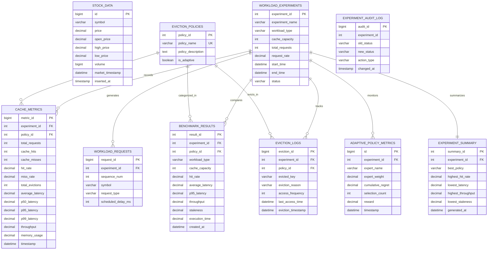

# Relational DBMS Design: adaptive_cache_db

This document details the database architecture, schema normalization, indexes, stored procedures, views, triggers, and transaction management in MySQL 8.x.

---

## 1. Entity-Relationship (ER) Diagram

---

## 2. Table Specifications & Constraints

### A. `stock_data`
- **Primary Key**: `id BIGINT AUTO_INCREMENT`
- **Composite Index**: `idx_stock_symbol_time (symbol, market_timestamp)`
- **Check Constraints**: `CHECK (price >= 0)`, `CHECK (high_price >= low_price)`
- **Purpose**: High-throughput storage of minute-level ticker quotes ingested via `yfinance`.

### B. `eviction_policies`
- **Primary Key**: `policy_id INT AUTO_INCREMENT`
- **Unique Constraint**: `UNIQUE (policy_name)`
- **Initial Seeds**: `LRU`, `LFU`, `FIFO`, `RANDOM`, `ADAPTIVE`.

### C. `workload_experiments`
- **Primary Key**: `experiment_id INT AUTO_INCREMENT`
- **Check Constraints**: `CHECK (cache_capacity > 0)`, `CHECK (total_requests >= 0)`
- **Status Lifecycle**: `INITIALIZED` -> `RUNNING` -> `COMPLETED`.

### D. `benchmark_results`
- **Primary Key**: `result_id INT AUTO_INCREMENT`
- **Foreign Keys**: `FK_experiment (ON DELETE CASCADE)`, `FK_policy (ON DELETE RESTRICT)`
- **Unique Constraint**: `UNIQUE (experiment_id, policy_id)` — ensures exactly one result row per policy per experiment run.

### E. `adaptive_policy_metrics`
- **Foreign Key**: `FK_experiment (ON DELETE CASCADE)`
- **Check Constraint**: `CHECK (expert_weight >= 0.0 AND expert_weight <= 1.0)`
- **Purpose**: Stores historical trajectories of weights $w_1, w_2$ and cumulative regret.

---

## 3. SQL Views

| View Name | Primary Role | Base Tables |
| :--- | :--- | :--- |
| `vw_policy_performance` | Aggregates all-time average, min, max hit rate, latency, throughput, and staleness per policy. | `eviction_policies`, `benchmark_results` |
| `vw_experiment_comparison` | Matrix view joining experiment parameters with policy metrics. | `workload_experiments`, `benchmark_results`, `eviction_policies` |
| `vw_stock_history` | Aggregates quote count, min/max price, volume, and date range per symbol. | `stock_data` |
| `vw_eviction_statistics` | Analyzes eviction count and key frequency at the moment of eviction. | `eviction_logs`, `eviction_policies` |

---

## 4. Stored Procedures & Triggers

### Stored Procedures
- `sp_get_experiment_summary(IN p_exp_id INT)`: Automatically identifies the optimal eviction policy (highest hit rate, lowest latency, highest throughput), populating `experiment_summary`.
- `sp_compare_eviction_policies(IN p_exp_id INT)`: Returns comparative matrix records sorted by hit rate for an experiment.
- `sp_record_benchmark_transaction(...)`: Demonstrates atomic insertion of benchmark records enclosed within `START TRANSACTION`, `COMMIT`, and `ROLLBACK` error handlers.

### Triggers
- `trg_experiment_status_audit`: Automatically inserts an audit record into `experiment_audit_log` whenever an experiment's `status` changes.
- `trg_experiment_create_audit`: Automatically audits new experiment registrations.
